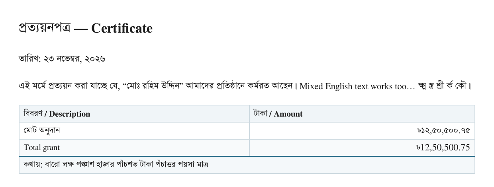

# Laravel Bangla PDF

[](https://github.com/rashed50702/laravel-bangla-pdf/actions/workflows/tests.yml)
[](https://packagist.org/packages/rashed50702/laravel-bangla-pdf)
[](https://packagist.org/packages/rashed50702/laravel-bangla-pdf)
[](LICENSE)

Generate **Bangla (Bengali) + English PDFs** in Laravel with [mPDF](https://mpdf.github.io), without fighting fonts.

- Correct Bangla shaping: conjuncts (যুক্তবর্ণ), reph, vowel signs
- Bangla and English in the same sentence, each in the right font automatically
- No more boxes for `—` `“ ”` `…` `।`
- Works out of the box with zero font setup, or with SolaimanLipi, Kalpurush, Nikosh
- Bangla digits, lakh/crore grouping, Taka formatting, **amount in words** (কথায়: ... টাকা মাত্র), Bangla dates
- Blade directives, a fluent API, and a `doctor` command that tells you if your font will work



> Download the [sample PDF](art/sample.pdf) produced by `php artisan bangla-pdf:doctor --sample`.

## Requirements

- PHP 8.3+
- Laravel 12 or 13
- `ext-mbstring`, `ext-gd`

## Installation

```bash
composer require rashed50702/laravel-bangla-pdf
```

Optionally publish the config and the default stylesheet:

```bash
php artisan vendor:publish --tag=bangla-pdf-config
php artisan vendor:publish --tag=bangla-pdf-css
```

Check everything works:

```bash
php artisan bangla-pdf:doctor --sample=storage/app/bangla-sample.pdf
```

## Usage

### From a Blade view

```php
use Rashed50702\BanglaPdf\Facades\BanglaPdf;

public function certificate(Application $application)
{
    return BanglaPdf::view('pdf.certificate', ['application' => $application])
        ->title('প্রত্যয়নপত্র')
        ->download("certificate-{$application->id}.pdf");
}
```

### From HTML

```php
BanglaPdf::html('<h2>প্রত্যয়নপত্র — Certificate</h2><p>আমার সোনার বাংলা। Mixed English works too.</p>')
    ->stream('certificate.pdf');
```

### Landscape, header, footer, extra CSS, saving

```php
BanglaPdf::make(['orientation' => 'L'])
    ->css(resource_path('css/pdf/report.css'))
    ->header('pdf.partials.header', ['title' => 'মাসিক প্রতিবেদন'])
    ->footer('<div style="text-align: right;">পৃষ্ঠা {PAGENO} / {nbpg}</div>')
    ->view('pdf.report', compact('rows'))
    ->save(storage_path('app/reports/monthly.pdf'));
```

### Available methods

| Method | Description |
|---|---|
| `BanglaPdf::make(array $overrides = [])` | New document, optionally overriding any config value |
| `BanglaPdf::view($view, $data)` / `BanglaPdf::html($html)` | Shortcuts for `make()->view()` / `make()->html()` |
| `->view($view, $data)` | Append a rendered Blade view |
| `->html($html)` | Append raw HTML |
| `->css($cssOrPath)` | Add CSS from a string or a file path |
| `->header($viewOrHtml, $data)` / `->footer(...)` | Page header / footer (supports `{PAGENO}` and `{nbpg}`) |
| `->pageBreak()` | Start a new page |
| `->title($title)` | PDF document title |
| `->watermark($text, $alpha)` | Light text watermark |
| `->download($filename)` / `->stream($filename)` | HTTP response (attachment / inline) |
| `->save($path)` | Write to disk, returns the path |
| `->output()` | Raw PDF bytes |
| `->mpdf()` | The underlying `Mpdf` instance for anything else |

## Bangla helpers

```php
use Rashed50702\BanglaPdf\Support\Bangla;

Bangla::digits(2026);                  // ২০২৬
Bangla::englishDigits('১২৩');          // 123
Bangla::number(12345678);              // ১,২৩,৪৫,৬৭৮
Bangla::taka(1250500.75);              // ৳১২,৫০,৫০০.৭৫
Bangla::taka(1250500.75, banglaDigits: false); // ৳12,50,500.75
Bangla::words(125500);                 // এক লক্ষ পঁচিশ হাজার পাঁচশত
Bangla::takaInWords(1250500.75);       // বারো লক্ষ পঞ্চাশ হাজার পাঁচশত টাকা পঁচাত্তর পয়সা মাত্র
Bangla::date('2026-03-05');            // ৫ মার্চ, ২০২৬
Bangla::date($date, 'l, d F Y h:i A'); // বৃহস্পতিবার, ০৫ মার্চ ২০২৬ ০২:৩০ অপরাহ্ণ
```

### Blade directives

```blade
<td class="text-right">@taka($row->amount)</td>
<p>কথায়: @takaInWords($total)</p>
<p>তারিখ: @bnDate($application->created_at)</p>
<p>ক্রমিক: @bnDigits($loop->iteration)</p>
<p>মোট পরিবার: @bnNumber($count)</p>
```

Every directive accepts the same arguments as its helper, for example `@taka($amount, 0)` or `@bnDate($date, 'd/m/Y')`.

## Choosing a Bangla font

By default the package uses **FreeSerif**, which ships with mPDF, so it works with no setup. FreeSerif has no Bangla bold, so bold Bangla text is shown in the regular weight.

For a more familiar look and real bold, use SolaimanLipi, Kalpurush or Nikosh:

1. Put the `.ttf` files in `storage/fonts/bangla-pdf` (or change `font_path`).
2. Register them in `config/bangla-pdf.php` and choose the Bangla font:

```php
'bengali_font' => 'solaimanlipi',
'bengali_scale' => 1.0,

'fonts' => [
    'solaimanlipi' => ['R' => 'SolaimanLipi.ttf', 'B' => 'SolaimanLipi_Bold.ttf'],
],
```

3. Run `php artisan bangla-pdf:doctor` to confirm mPDF can read it.

> **Do not use Noto Sans Bengali or Noto Serif Bengali with mPDF.** Recent releases use OpenType features mPDF cannot read. Depending on the file, mPDF either throws `GPOS Lookup Type 5, Format 3 not supported` (which `doctor` reports) or hangs while building the font cache.

### How the font switching works

mPDF uses one font per text run, not one per character like a browser. If your Bangla font has no `—` or `“`, you get boxes. This package:

- turns on mPDF's script detection, so Bangla runs use `bengali_font` and everything else uses `latin_font`
- wraps typographic punctuation (`— – ‘ ’ “ ” … •` and their HTML entities) in the Latin font, and the danda (`। ॥`) in the Bangla font, only in text, never inside attributes, `<style>` or `<script>`
- scales Bangla runs by `bengali_scale` so Bangla and English look the same size in the same line

Turn the punctuation handling off with `'protect_punctuation' => false`.

## Configuration

| Key | Default | Description |
|---|---|---|
| `bengali_font` | `freeserifbangla` | Font used for Bangla text |
| `latin_font` | `freeserif` | Font used for English and everything else |
| `bengali_scale` | `1.15` | Size multiplier for Bangla runs. Use `1.0` for SolaimanLipi / Kalpurush |
| `font_path` | `storage/fonts/bangla-pdf` | Folder with your own `.ttf` files |
| `fonts` | `[]` | Extra fonts: `name => ['R' => ..., 'B' => ..., 'I' => ..., 'BI' => ...]` |
| `protect_punctuation` | `true` | Fix boxes for typographic punctuation and danda |
| `temp_dir` | `storage/app/bangla-pdf/temp` | mPDF temp and font cache folder |
| `format` / `orientation` | `A4` / `P` | Paper size and orientation (`L` for landscape) |
| `margins` | top 10, right 8, bottom 15, left 8 | In millimetres, plus `header` / `footer` |
| `stylesheet` | package CSS | Path to your base CSS, or `false` for none |
| `footer` | `null` | Default footer view or HTML for every document |
| `mpdf` | `[]` | Any raw mPDF option, applied last |

The default stylesheet uses light table colours that print cleanly without wasting ink.

## Testing

```bash
composer test
```

## License

MIT. See [LICENSE](LICENSE).
